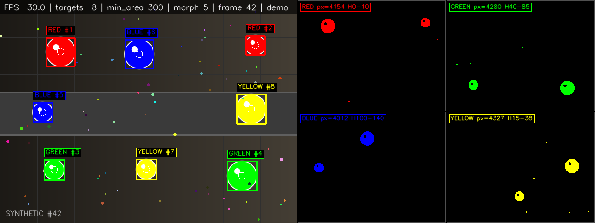
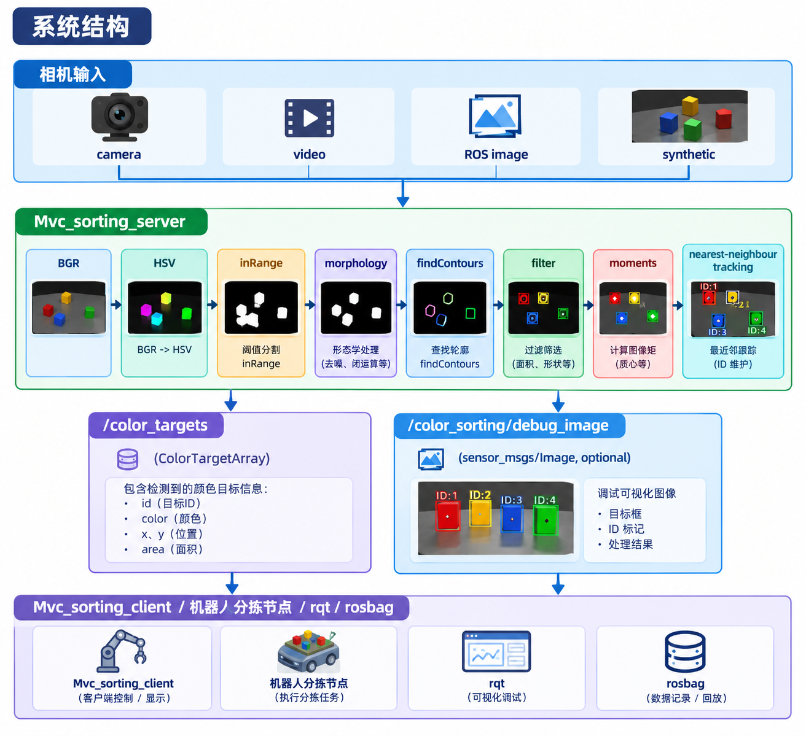
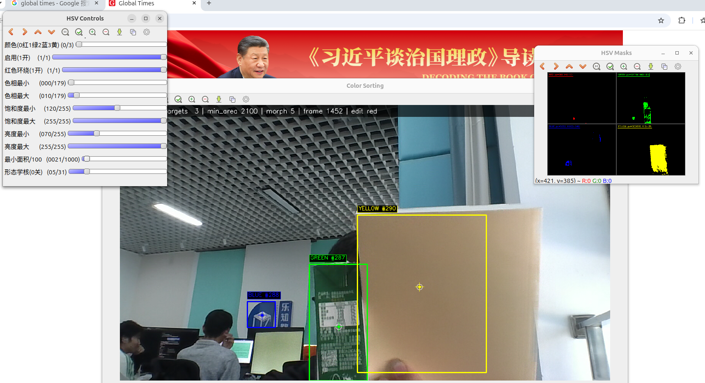

# 机器视觉颜色分拣系统（ROS 2 视觉目标输出）

基于 ROS 2 Jazzy 框架实现：复用 `color_sorting_interfaces` 中的
`ColorTarget` / `ColorTargetArray` 消息，由 `Mvc_sorting` 包完成摄像头采集、HSV
阈值分割、形态学去噪、轮廓筛选、色块中心计算、ID 跟踪、画面标注和 ROS 话题发布。



## 功能

- 支持 4 种输入：USB/CSI 摄像头、视频文件、ROS 图像话题、内置合成场景（无相机也能演示和测试）。
- 实时识别红 / 绿 / 蓝 / 黄四类色块，支持多目标同时检测。
- 中文 HSV 阈值 Trackbar 动态调参，带颜色选择、启用开关、红色 Hue 环绕、最小面积和形态学核调节。
- 颜色掩码生成，开运算 + 闭运算（腐蚀/膨胀）去噪，按面积、宽高、填充率过滤轮廓。
- 用图像矩计算色块质心，绘制包围框、中心十字和颜色名称。
- 简单 ID 跟踪：基于同色目标最近邻匹配，输出稳定 ID。
- 通过 `/color_targets` 发布 `color_sorting_interfaces/msg/ColorTargetArray`。
- 可选发布标注后的调试图像 `/color_sorting/debug_image`（`sensor_msgs/msg/Image`）。
- HSV 配置保存/加载 JSON：GUI 快捷键、ROS Trigger 服务、启动参数三种方式。
- 支持无显示环境（headless）运行；视频、滑块、掩码分开显示，互不遮挡。

## 系统结构



源码结构：

```text
src/
├── color_sorting_interfaces/          # 接口包
│   └── msg/
│       ├── ColorTarget.msg
│       └── ColorTargetArray.msg
└── Mvc_sorting/
    ├── Mvc_sorting/
    │   ├── Mvc_sorting_server.py      # 视觉服务端节点（主节点）
    │   ├── Mvc_sorting_client.py      # 目标列表订阅/控制台监视客户端
    │   ├── color_detector.py          # HSV 分割、轮廓筛选、ID 跟踪
    │   ├── hsv_config.py              # 配置模型、校验、JSON 读写
    │   ├── gui.py                     # Trackbar 调参面板
    │   ├── visualization.py           # 包围框、中心点、HUD、掩码拼图
    │   └── image_sources.py           # 无相机合成测试场景
    ├── config/hsv_colors.json         # 默认 HSV 配置示例
    ├── launch/color_sorting.launch.py
    └── test/                          # 单元测试与 ROS lint
```

## 构建

```bash
cd "/home/<user.name>/....../Machine_vision _color_sorting_system"
source /opt/ros/jazzy/setup.bash
colcon build --packages-select color_sorting_interfaces Mvc_sorting
source install/setup.bash
```

如果之前用不同的安装方式构建过，建议清理对应的 `build/`、`install/` 后重新构建。

## 运行

### 1. 无相机快速演示（推荐先跑这个）

```bash
ros2 launch Mvc_sorting color_sorting.launch.py \
  input_type:=synthetic show_window:=true
```

合成画面包含 8 个移动色块（每种颜色 2 个）和细小噪点，可同时验证多目标、去噪、
中心点、ID 跟踪和可视化。无显示环境使用：

```bash
ros2 launch Mvc_sorting color_sorting.launch.py \
  input_type:=synthetic show_window:=false max_frames:=120
```


### 2. USB / CSI 摄像头

```bash
ros2 launch Mvc_sorting color_sorting.launch.py \
  input_type:=camera camera_index:=0 show_window:=true
```

默认会请求 `1280x720` 和自动对焦；如果摄像头不支持，会自动回退到 `640x480`
安全模式，日志会打印实际分辨率、FOURCC、对焦值和使用的后端（V4L2/auto）。
Linux 下优先使用 V4L2，避免 GStreamer 对 MJPG/对焦属性的兼容问题。

如果摄像头支持 MJPG，可显式加 `camera_fourcc:=MJPG` 提升 720p 下的帧率：

```bash
ros2 launch Mvc_sorting color_sorting.launch.py \
  input_type:=camera camera_index:=0 \
  frame_width:=1280 frame_height:=720 camera_fourcc:=MJPG \
  camera_autofocus:=true display_sharpen:=0.35 show_window:=true
```

等价的 `ros2 run` 形式：

```bash
ros2 run Mvc_sorting Mvc_sorting_server --ros-args \
  -p input_type:=camera -p camera_index:=0 \
  -p frame_width:=1280 -p frame_height:=720 -p fps:=30.0 \
  -p camera_autofocus:=true
```



### 3. 视频文件

```bash
ros2 launch Mvc_sorting color_sorting.launch.py \
  input_type:=video video_path:=/absolute/path/demo.mp4 show_window:=true
```

### 4. 订阅 ROS 图像话题

适用于 `usb_cam`、`v4l2_camera`、Gazebo 相机、RealSense 等驱动：

```bash
ros2 launch Mvc_sorting color_sorting.launch.py \
  input_type:=topic image_topic:=/camera/image_raw show_window:=true
```

### 5. 启动目标监视客户端

```bash
ros2 run Mvc_sorting Mvc_sorting_client --ros-args \
  -p targets_topic:=/color_targets
```

输出示例：

```text
frame 2: 8 target(s), stamp=1792455360.332, frame_id='camera_optical_frame'
  id=  1  red     x=  222.00  y=  175.01  area=  6438.00
  id=  2  red     x= 1095.58  y=  161.12  area=  2502.00
  id=  3  green   x=  263.00  y=  546.00  area=  2930.00
  ...
```

可选参数：`print_json:=true` 输出 JSON；`max_messages:=5` 收到 5 帧后退出。
也可以直接：

```bash
ros2 topic echo /color_targets
```

### 6. 调试图像

```bash
ros2 run Mvc_sorting Mvc_sorting_server --ros-args \
  -p input_type:=camera -p publish_debug_image:=true -p show_window:=false
rqt_image_view /color_sorting/debug_image
```

调试图像使用 sensor-data QoS（Best Effort），自定义订阅端请使用
`rclpy.qos.qos_profile_sensor_data`。

## 调参界面

这些窗口不是额外启动的 GUI 程序，而是服务端在 `show_window:=true` 时通过 OpenCV
highgui 自动创建的。默认启动命令即可打开，不需要另开窗口：

```bash
ros2 launch Mvc_sorting color_sorting.launch.py \
  input_type:=camera show_window:=true show_trackbars:=true show_masks:=true
```

现在分成三个窗口，互不遮挡：

- `Color Sorting`：摄像头/视频画面和检测标注。
- `HSV Controls`：中文 HSV 滑块。窗口标题保留 ASCII 是 OpenCV Qt 后端不支持中文窗口名的限制。
- `HSV Masks`：四色掩码预览，可按 `m` 隐藏。

| 中文滑块 | 范围 | 说明 |
|---|---|---|
| `颜色(0红1绿2蓝3黄)` | 0–3 | 当前编辑的颜色，切换后滑块会显示该颜色的阈值 |
| `启用(1开)` | 0/1 | 是否启用当前颜色 |
| `红色环绕(1开)` | 0/1 | 红色专用：除色相下限–上限外，再叠加靠近 180 的环绕区间 |
| `色相最小` / `色相最大` | 0–179 | OpenCV HSV 色相范围 |
| `饱和度最小` / `饱和度最大` | 0–255 | 饱和度范围，光照变化大时优先调它 |
| `亮度最小` / `亮度最大` | 0–255 | 明度范围 |
| `最小面积/100` | 0–1000 | 最小轮廓面积，实际值 = 滑块值 × 100 像素² |
| `形态学核(0关)` | 0–31 | 形态学核大小，0/1 表示关闭；检测时自动取奇数 |

快捷键（先点击 OpenCV 窗口使其获得焦点）：

| 按键 | 功能 |
|---|---|
| `s` | 保存当前 HSV 配置到 `config_path` |
| `l` | 从 `config_path` 重新加载 |
| `r` | 恢复内置默认配置 |
| `m` | 显示/隐藏掩码预览窗口 |
| `h` | 打印快捷键帮助 |
| `q` / `Esc` | 退出 |

## HSV JSON 配置

默认路径为 `~/.ros/color_sorting_hsv.json`；存在时服务端启动自动加载。也可以指定：

```bash
ros2 run Mvc_sorting Mvc_sorting_server --ros-args \
  -p config_path:=/absolute/path/my_hsv.json
```

使用仓库中的示例：

```bash
mkdir -p ~/.ros
cp "$(ros2 pkg prefix Mvc_sorting)/share/Mvc_sorting/config/hsv_colors.json" \
   ~/.ros/color_sorting_hsv.json
```

保存/加载服务：

```bash
ros2 service call /Mvc_sorting_server/save_config std_srvs/srv/Trigger
ros2 service call /Mvc_sorting_server/load_config std_srvs/srv/Trigger
```

JSON 结构（可只写需要修改的字段，缺失项使用默认值）：

```json
{
  "version": 2,
  "colors": {
    "red": {
      "enabled": true,
      "wrap_hue": true,
      "lower": [0, 120, 70],
      "upper": [10, 255, 255]
    },
    "green":  { "enabled": true, "wrap_hue": false, "lower": [40, 80, 50],  "upper": [85, 255, 255] },
    "blue":   { "enabled": true, "wrap_hue": false, "lower": [100, 120, 70], "upper": [140, 255, 255] },
    "yellow": { "enabled": true, "wrap_hue": false, "lower": [15, 80, 80], "upper": [38, 255, 255] }
  },
  "filter": {
    "min_area": 300,
    "max_area": 0,
    "min_dimension": 8,
    "min_fill_ratio": 0.2
  },
  "morphology": {
    "kernel": 5,
    "iterations": 1,
    "blur_kernel": 3
  }
}
```

- 当前配置版本为 2。旧版本配置如果黄色仍是 `[20,100,100]`–`[35,255,255]`，加载时会自动迁移到新的黄色范围；用户自定义的黄色阈值不会被覆盖。
- `wrap_hue: true` 时，红色会同时使用 `[lower, upper]` 和 `[180-upper_h, 179]` 两段 H 区间。
- `max_area: 0` 表示不限制；`min_fill_ratio` 为轮廓面积 / 外接矩形面积，用于过滤细长噪点。
- `kernel` 为形态学核大小（自动取奇数）；`blur_kernel` 在 BGR→HSV 后做高斯平滑。
- 校验失败时节点会拒绝启动/加载并在日志中给出字段名。

开启 `auto_save:=true` 后，节点退出时自动写回配置。

## ROS 接口

### 发布话题

| 话题 | 类型 | 说明 |
|---|---|---|
| `/color_targets` | `color_sorting_interfaces/msg/ColorTargetArray` | 色块列表，默认每帧发布；无目标时发布空列表 |
| `/color_sorting/debug_image` | `sensor_msgs/msg/Image` | 标注画面，`publish_debug_image:=true` 时发布 |

`ColorTargetArray` 使用现有消息：

```text
std_msgs/Header header
ColorTarget[] targets
```

`ColorTarget`：

```text
uint32 id       # 跟踪 ID（跟踪关闭时为每帧序号）
string color    # red / green / blue / yellow
float32 x       # 色块质心像素坐标，原点左上角，向右为 +x
float32 y       # 色块质心像素坐标，向下为 +y
float32 area    # 轮廓面积，单位像素²
```

默认 `header.frame_id` 为 `camera_optical_frame`，可通过 `frame_id` 参数修改；
`header.stamp` 在摄像头模式下取 ROS 时间，在图像话题模式下沿用输入图像时间戳。

### 服务

| 服务 | 类型 | 说明 |
|---|---|---|
| `~/save_config` | `std_srvs/srv/Trigger` | 保存当前配置到 `config_path` |
| `~/load_config` | `std_srvs/srv/Trigger` | 从 `config_path` 加载配置并重置跟踪 |

### 主要参数

| 参数 | 默认值 | 说明 |
|---|---|---|
| `input_type` | `camera` | `camera` / `video` / `topic` / `synthetic` |
| `camera_index` | `0` | OpenCV 摄像头编号 |
| `camera_backend` | `auto` | `auto` 在 Linux 优先 V4L2、失败自动回退；`v4l2` 强制 V4L2 |
| `camera_fourcc` | `""` | 可选 FOURCC，如 `MJPG`/`YUYV`；空字符串交给驱动选择 |
| `camera_autofocus` | `true` | 支持时开启连续自动对焦 |
| `camera_focus` | `-1` | 手动对焦值，设置后关闭自动对焦；-1 不设置 |
| `camera_sharpness` | `-1` | 摄像头硬件锐度；-1 保持驱动默认 |
| `camera_warmup_frames` | `5` | 打开摄像头后丢弃的预热帧数 |
| `display_sharpen` | `0.35` | 仅显示/调试图像的 USM 锐化量，0 关闭，不影响检测 |
| `min_hits` | `2` | 目标连续出现多少帧后才发布，用于抑制闪烁噪点 |
| `video_path` | `""` | `input_type:=video` 时的视频文件 |
| `image_topic` | `/camera/image_raw` | `input_type:=topic` 时的输入话题 |
| `frame_width` / `frame_height` | `1280` / `720` | 请求的摄像头/合成场景分辨率 |
| `fps` | `30.0` | 采集定时器频率 |
| `targets_topic` | `/color_targets` | 输出话题 |
| `debug_image_topic` | `/color_sorting/debug_image` | 调试图像话题 |
| `frame_id` | `camera_optical_frame` | Header 坐标系 |
| `show_window` | `true` | 显示标注窗口；无显示环境自动 headless |
| `show_masks` | `true` | 显示掩码窗口 |
| `show_trackbars` | `true` | 创建中文 HSV 滑块窗口 `HSV Controls` |
| `publish_debug_image` | `false` | 是否发布标注图像 |
| `config_path` | `""` | 空则使用 `~/.ros/color_sorting_hsv.json` |
| `auto_save` | `false` | 退出时自动保存配置 |
| `enable_tracking` | `true` | 是否保持稳定 ID |
| `track_max_distance` | `80.0` | 最近邻匹配最大像素距离 |
| `track_max_age` | `15` | 目标丢失多少帧后删除轨迹 |
| `max_targets` | `20` | 单帧最多发布/绘制目标数，0 表示不限制 |
| `max_frames` | `0` | 处理 N 帧后自动退出，0 表示不限制（测试用） |
| `publish_empty` | `true` | 无目标时是否发布空数组 |
| `print_targets` | `true` | 是否周期打印目标摘要 |
| `log_period` | `1.0` | 目标摘要打印周期（秒） |
| `initial_min_area` | `-1` | 启动时覆盖配置中的最小面积，-1 不覆盖 |
| `initial_morph_kernel` | `-1` | 启动时覆盖形态学核大小，-1 不覆盖 |
| `loop_video` | `false` | 视频结束后是否循环 |

完整列表可查看：

```bash
ros2 param list /Mvc_sorting_server
ros2 param describe /Mvc_sorting_server input_type
```

## 算法流程

1. `cv2.cvtColor(frame, COLOR_BGR2HSV)`，可选高斯模糊。
2. 对每种颜色用 `cv2.inRange` 生成掩码；红色通过 `wrap_hue` 合并两段 Hue。
3. `MORPH_OPEN`（先腐蚀后膨胀）去小噪点，`MORPH_CLOSE` 补洞。
4. `cv2.findContours(..., RETR_EXTERNAL, CHAIN_APPROX_SIMPLE)`。
5. 按 `area`、`min_dimension`、`min_fill_ratio`、`max_area` 过滤。
6. `cv2.moments` 计算质心；矩为零时回退到外接矩形中心。
7. 同色目标按最近邻匹配上一帧轨迹，距离超过阈值则分配新 ID。
8. 目标连续出现 `min_hits` 帧后才发布，抑制闪烁噪点。
9. 组装 `ColorTargetArray` 发布，同时绘制标注画面/掩码。

## 测试

```bash
source /opt/ros/jazzy/setup.bash
source install/setup.bash
colcon test --packages-select Mvc_sorting
colcon test-result --verbose
```

测试包含：

- HSV 配置默认值、JSON 往返、非法值拒绝、红色 Hue 环绕。
- 四色检测、噪点过滤、最小面积、颜色禁用、红色 H=175、黄色 H=17/H=37 检测。
- 跟踪 ID 保持、超距离分配新 ID、`min_hits` 两帧确认。
- 旧版黄色配置自动迁移、用户自定义黄色不被覆盖。
- `ament_flake8`、`ament_pep257`、`ament_copyright`（模板中 copyright 测试保持跳过）。

无 ROS 环境快速跑纯算法测试：

```bash
PYTHONPATH=src/Mvc_sorting python3 -m pytest \
  src/Mvc_sorting/test/test_color_detector.py \
  src/Mvc_sorting/test/test_hsv_config.py -v
```

## 常见问题

- **打不开摄像头**：确认 `ls /dev/video*`、设备权限和 `camera_index`；没有相机时用
  `input_type:=synthetic` 或 `input_type:=topic`。Linux 会先试 V4L2，失败会回退到
  `640x480` 安全模式，具体后端和实际分辨率看启动日志。
- **看不到摄像头画面**：视频在 `Color Sorting` 窗口，滑块在 `HSV Controls` 窗口，
  掩码在 `HSV Masks` 窗口。若被其他窗口盖住，把 `Color Sorting` 窗口切到前面即可。
- **没有图形界面 / SSH**：设置 `show_window:=false`，或 `export CV2_HEADLESS=1`；
  用 `/color_sorting/debug_image` + `rqt_image_view` 查看画面。
- **画面模糊**：服务默认请求 1280x720 和自动对焦，启动日志会打印实际分辨率、
  FOURCC、focus 和后端。若仍模糊：擦净镜头；用 `camera_focus:=<数值>` 手动对焦；
  `display_sharpen:=0.6` 增强显示锐度；需要 720p 高帧率时试 `camera_fourcc:=MJPG`；
  低光环境可增加补光，避免长曝光造成运动模糊。
- **黄色识别不到**：新默认黄色范围为 H 15–38、S/V ≥ 80，已覆盖偏橙/偏暗的黄色。
  若仍不稳定，把 `颜色(0红1绿2蓝3黄)` 切到 3（黄），确认 `启用(1开)=1`，适当降低
  `饱和度最小` / `亮度最小` 或扩大 `色相最小`–`色相最大`。旧版默认黄色配置会在
  加载时自动迁移；如果曾保存过自定义配置，可按 `r` 恢复默认后再调。
- **误检背景**：优先提高 `饱和度最小` / `亮度最小`，再调 `色相最小` / `色相最大`；
  白色/灰色物体饱和度低，通常提高 `饱和度最小` 即可排除。
- **红色只检到一半**：确认 `红色环绕(1开)` 为 1（红色跨越 H=0/180）。
- **小目标检不到**：降低 `最小面积/100` 或修改 JSON 的 `filter.min_area`。
- **配置保存失败**：检查 `config_path` 是否可写；容器/只读系统中请显式指定可写目录。
- **调试图像订阅不到**：使用 sensor-data QoS（Best Effort），不要用默认 Reliable 订阅。
- **ID 偶尔互换**：当前为轻量最近邻跟踪；目标交叉或颜色接近时可减小
  `track_max_distance`/`track_max_age`，或接入更完整的跟踪器。
- **构建提示包名大写**：`Mvc_sorting` 沿用了工作区原有包名，colcon 会给出命名规范
  警告，但不影响构建和运行。

## 对接机器人

机器人侧只需订阅 `/color_targets`，按业务策略选择目标（例如按 `area` 最大、按
`id` 稳定或按颜色优先级），再结合相机内参、手眼标定和传送带坐标把像素坐标
`(x, y)` 转换到机械臂/小车坐标系后执行抓取。服务端只负责“看到什么、在哪里”，
不绑定具体机器人接口，便于替换执行端。

## 可扩展方向

- 增加 `std_srvs` / 自定义服务，让机器人主动请求一次检测结果。
- 增加像素坐标到相机/机械臂坐标的 TF 或标定参数。
- 用 `cv2.CamShift`、Kalman 或 ByteTrack 替换简单最近邻跟踪。
- 增加颜色学习：从 ROI 采样自动估计 HSV 范围。
- 接入 `rosbag2` 录制目标与调试图像，用于离线回归测试。
