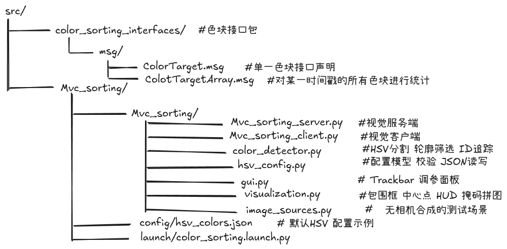

> 按项目结构逐步讲解，先跑通纯 Python 视觉模块，再接入 ROS 2。

教程结合分段源码、中文解释、参数表和验收示例，帮助复刻项目并学习 ROS 2 与 OpenCV。
命令中的 `$WS` 表示工作区根目录；每个新终端先设置工作区路径，再加载 ROS 和构建后的工作区环境。

```bash
export WS="$HOME/color_sorting_ws"
cd "$WS"
source /opt/ros/jazzy/setup.bash
# 首次构建成功后再加载：
source install/setup.bash
```

# 目录

- [一.接口包(color_sorting_interfaces)](%E4%B8%80.%E6%8E%A5%E5%8F%A3%E5%8C%85%28color_sorting_interfaces%29.md)
- [二.包骨架创建与 HSV 配置层](%E4%BA%8C.%E5%8C%85%E9%AA%A8%E6%9E%B6%E5%88%9B%E5%BB%BA%26hsv_config.py.md)
- [三.检测与跟踪层：color_detector.py](%E4%B8%89.%E6%A3%80%E6%B5%8B%E4%B8%8E%E8%B7%9F%E8%B8%AA%E5%B1%82%EF%BC%9Acolor_detector.py.md)
- [四.可视化层：visualization.py](%E5%9B%9B.%E5%8F%AF%E8%A7%86%E5%8C%96%E5%B1%82%EF%BC%9Avisualization.py.md)
- [五.中文调参面板：gui.py](%E4%BA%94.%E4%B8%AD%E6%96%87%E8%B0%83%E5%8F%82%E9%9D%A2%E6%9D%BF%EF%BC%9Agui.py.md)
- [六.合成测试场景：image_sources.py](%E5%85%AD.%E5%90%88%E6%88%90%E6%B5%8B%E8%AF%95%E5%9C%BA%E6%99%AF%EF%BC%9Aimage_sources.py.md)
- [七.ROS 视觉服务端：Mvc_sorting_server.py](%E4%B8%83.ROS%E8%A7%86%E8%A7%89%E6%9C%8D%E5%8A%A1%E7%AB%AF%EF%BC%9AMvc_sorting_server.py.md)
- [八.订阅客户端：Mvc_sorting_client.py](%E5%85%AB.%E8%AE%A2%E9%98%85%E5%AE%A2%E6%88%B7%E7%AB%AF%EF%BC%9AMvc_sorting_client.py.md)
- [九.配置、launch 与测试](%E4%B9%9D.%E9%85%8D%E7%BD%AE%E3%80%81launch%E4%B8%8E%E6%B5%8B%E8%AF%95.md)
